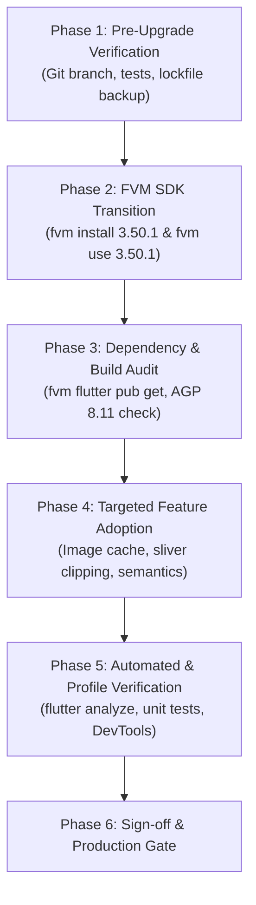

# KhelBhai — Flutter 3.50 Staged Migration Plan

## 1. Migration Strategy & Core Principles

This migration plan defines the step-by-step procedure to transition KhelBhai from **Flutter 3.47.5** to **Flutter 3.50.1** with **zero production downtime**, **zero architectural refactoring**, and **zero dependency breakage**.

### Guiding Principles
1. **Never upgrade globally**: All operations must execute through FVM (`fvm flutter`, `fvm dart`).
2. **Preserve Clean Architecture**: Do not modify Supabase backend queries, BLoC state contracts, or route paths.
3. **Isolate Feature Adoption**: Migrate the engine and framework first; adopt new APIs only in targeted, verified locations.
4. **Strict Verification Gates**: Each phase must pass static analysis and unit tests before moving to the next.

---

## 2. Phase-by-Phase Execution Roadmap



---

## 3. Phase 1: Pre-Upgrade Baseline & Lockfile Protection

1. **Verify Clean Git Working Directory**:
   ```bash
   git status
   git checkout -b feature/flutter-350-upgrade
   ```
2. **Backup Dependency Lockfile**:
   ```bash
   cp pubspec.lock pubspec.lock.3475.bak
   ```
3. **Verify Baseline Test Suite**:
   ```bash
   fvm flutter test
   fvm flutter analyze
   ```
   *Gate*: All 17 feature tests must pass, 0 analysis warnings.

---

## 4. Phase 2: FVM SDK Transition

1. **Install Flutter 3.50.1 via FVM**:
   ```bash
   fvm install 3.50.1
   ```
2. **Switch Project Configuration**:
   ```bash
   fvm use 3.50.1 --force
   ```
3. **Verify Active Version in `.fvmrc`**:
   ```json
   {
     "flutter": "3.50.1"
   }
   ```
4. **Verify Environment**:
   ```bash
   fvm flutter --version
   fvm dart --version
   ```

---

## 5. Phase 3: Compilation & Platform Tooling Validation

### Android Tooling Check
- **Gradle Version**: `8.14-all` (Verified compatible)
- **AGP Version**: `8.11.1` (Verified compatible)
- **Kotlin Version**: `2.2.20` (Verified compatible)
- **Java Runtime**: JDK 17 (Verified compatible)
- **Desugaring**: Android core library desugaring is already enabled in `app/build.gradle.kts`.

### iOS Tooling Check
- **CocoaPods**: Run `pod repo update` and `pod install` in `ios/`.
- **Deployment Target**: iOS 13.0+ minimum verified.

### Dependency Resolution
```bash
# Resolve dependencies against Flutter 3.50.1 SDK without breaking changes
fvm flutter pub get
```

---

## 6. Phase 4: Targeted Feature Adoption

### 4.1. Adopt `ResizeImage.useLogicalSize` in Image Pipeline
**File**: `lib/core/widgets/app_cached_network_image.dart`
- Replace manual DPR multiplication with engine-level logical size bounds:
```dart
// Enhanced with Flutter 3.50 ResizeImage.useLogicalSize
ImageProvider _getBoundedImageProvider(ImageProvider provider, BuildContext context) {
  if (width == null && height == null) return provider;
  return ResizeImage.useLogicalSize(
    provider,
    width: width?.round(),
    height: height?.round(),
  );
}
```

### 4.2. Adopt `SliverClipRRect` on Feed Slivers
**Files**:
- `lib/features/spot/presentation/pages/home_screen.dart`
- `lib/features/spot/presentation/pages/manage_requests_screen.dart`
- Wrap scrolling sliver lists in `SliverClipRRect` where outer card clipping was previously eliminated, ensuring clean overscroll containment without GPU offscreen buffer penalties.

### 4.3. Accessibility Polish on Swipe Gestures
**File**: `lib/features/spot/presentation/widgets/manage_join_request_card.dart`
- Wrap `Dismissible` in explicit `Semantics`:
  - `label: 'Swipe right to accept request from ${displayName}, swipe left to reject'`
  - Ensure screen readers provide accessibility actions for both Accept and Reject.

---

## 7. Phase 5: Testing & Performance Verification Gate

Run full verification suite:
```bash
# 1. Static analysis
fvm flutter analyze

# 2. Complete unit test suite
fvm flutter test

# 3. Build Profile APK
fvm flutter build apk --profile

# 4. Profile Mode Startup and Memory Check
adb shell am start -W -n com.lastspot.app/.MainActivity
adb shell dumpsys meminfo com.lastspot.app
adb shell dumpsys gfxinfo com.lastspot.app
```

---

## 8. Phase 6: Rollback & Emergency Contingency Procedures

If any blocking issue or regression occurs during testing:

1. **Revert FVM to 3.47.5**:
   ```bash
   fvm use 3.47.5 --force
   ```
2. **Restore Dependency Lockfile**:
   ```bash
   cp pubspec.lock.3475.bak pubspec.lock
   fvm flutter pub get
   ```
3. **Rebuild Baseline**:
   ```bash
   fvm flutter clean
   fvm flutter build apk --profile
   ```
4. **Time to Recovery**: < 5 minutes.
